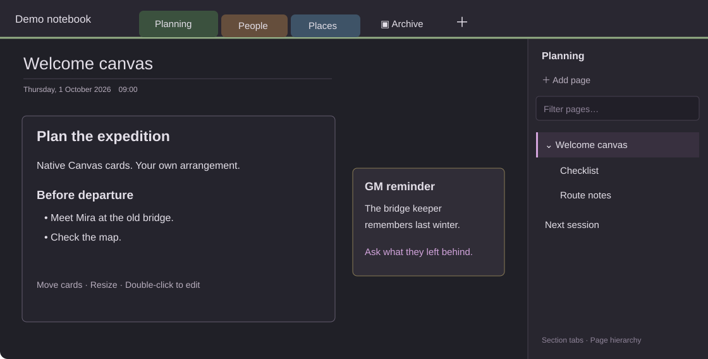

# Classic Notebook

A classic notebook interface for Obsidian: colored section tabs across the top, section groups, and a hierarchical page list on the right. Write on native Canvas pages or use ordinary Markdown notes.

**Desktop beta 3.4.0 · MIT · Obsidian 1.14.5+**

[Download the beta](https://github.com/SetupCoding/obsidian-classic-notebook/releases/tag/3.4.0) · [Deutsche Anleitung](docs/README.de.md) · [Alternatives](docs/ALTERNATIVES.md) · [Testing and limitations](docs/TESTING.md)



*Layout illustration using fictional notes, not an Obsidian screenshot.*

## What it does

- Colored section tabs, draggable ordering, section groups and a back button to the parent group.
- Nested pages up to five levels, collapsible children, drag ordering, rename and recoverable deletion.
- Native `.canvas` pages with freely positioned text cards, a title and creation date; Markdown pages are also supported.
- Remembered Canvas position, zoom and card scroll; explicit links and search hits retain their own destinations.
- Text colors, display-only automatic links from page names/aliases, and a picker for linking to a page, card, heading or paragraph.
- Exact text highlighting in supported Canvas text cards, including table cells. Complex embedded content can still require native Find.
- A light/dark switch, ribbon toggle and a setting to use your current theme colors.

No adventure, character list or link mapping is bundled. [GM Shortcuts](https://github.com/SetupCoding/obsidian-gm-shortcuts) is a separate, optional plugin.

## Install the beta

This plugin is **not yet listed in the Obsidian community directory**. Try it in a copy or disposable vault first.

1. Download `main.js`, `manifest.json` and `styles.css` from the linked release, or extract its ZIP.
2. Put the three files in `<your vault>/<your config folder>/plugins/classic-notebook/`. The config folder is normally `.obsidian`.
3. Reload Obsidian and enable **Classic Notebook** under Community plugins.
4. Run **Classic Notebook: Notizbuch anzeigen** from the command palette if the page list is not visible.

Alternatively, add `SetupCoding/obsidian-classic-notebook` through [BRAT](https://github.com/TfTHacker/obsidian42-brat), selecting the `3.4.0` beta release if needed. Manual release installation is the directly validated path.

## Start a notebook

Top-level vault folders become sections. Notes in the vault root appear under **Allgemein** (General). Existing files are left in place. Create a section with `+` or the notebook menu; create a section group from that menu. Enter a group to see its own set of tabs and use the back arrow to leave it.

Use **Seite hinzufügen** (Add page) to create a Canvas page. Under **Settings → Classic Notebook**, select Canvas or Markdown for future pages. The choice never converts existing notes; a notebook explicitly configured as Canvas-only continues using Canvas.

Right-click a page to rename, delete, indent or outdent it. Drag a page onto another page to nest it; its children move with it. The five-level limit applies to the whole branch. Click the Canvas page title to rename it directly.

Double-click a native Canvas text card to edit it. Move or resize the card using native Canvas controls. Reading and editing are still Markdown views: this plugin reduces common layout jumps but does not turn Canvas into a full rich-text editor.

The main notebook controls and command names are currently **German**; settings and this guide are English. Full UI localization is still pending.

## Settings and shortcuts

Settings expose new-page format, classic colors, automatic links and startup explorer collapse. Disable **Classic colors** to inherit the active theme's colors; structural notebook styling remains active. Other themes have not all been tested.

Use Obsidian's Hotkeys settings to assign commands. No global default shortcuts are installed. To search the vault with Ctrl+E, assign Obsidian's **Search: Search in all files** command yourself. Existing personal hotkey assignments are not changed.

For automatic links, open **Automatische Verknüpfungen verwalten**. These are display-only links: your source text is not rewritten. **Textstelle verknüpfen** inserts an explicit link from selected text to a chosen destination.

## Data and privacy

There is no telemetry, account requirement or plugin-initiated network access. All settings are vault-local. The plugin reads note content to build its local link/navigation indexes. [Data details](docs/DATA.md) explain metadata, deletion and uninstall behavior.

Markdown and Canvas remain normal files. Notebook-specific creation dates, aliases, card labels and anchors use an additional `notebook` object in Canvas JSON. Core Canvas can still display the cards without this plugin; notebook-specific navigation and metadata preservation depend on it. Other tools may discard unknown metadata.

**This distribution is not a generic OneNote importer.** Optional legacy import-profile support exists for previously converted notebooks, but conversion scripts and source exports are not bundled. See the alternatives for dedicated import tools.

## Development

Use Node.js 22.13+ or 24.x:

```sh
npm ci
npm run build
npm run check
npm run lint
npm test
```

The runtime has no bundled third-party dependencies. Obsidian and CodeMirror are supplied by Obsidian. `build.cjs` expands the shared source modules into the root `main.js`; the root runtime files are committed for installation and reproducibility. `npm run lint` is a documented subset of official Obsidian checks, not the full community security/review scan.

The companion repository has integration tests for character pages and shared TODOs. See [CONTRIBUTING.md](CONTRIBUTING.md) and [TESTING.md](docs/TESTING.md).

## Status and license

Released as an early desktop beta under [MIT](LICENSE). Windows is the development platform. macOS, Linux, mobile and broad third-party plugin compatibility have not been verified. Canvas enhancements use internal Obsidian interfaces and may need updates after an Obsidian release.

The community-directory submission and its automated review are **pending**. No approval by Obsidian is implied. Classic Notebook is independent of Microsoft and Obsidian.
